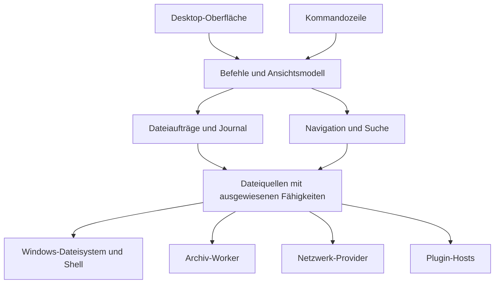

# Entwicklungsplan für Arco Commander

Arco Commander ist ein Windows-Dateimanager in Rust mit zwei unabhängig bedienbaren Dateifenstern und dem Tastaturablauf von Total Commander. [Version 1.0.0](https://github.com/Mucumba77/arco-commander/releases/tag/v1.0.0) ist die erste reguläre Veröffentlichung. Das Ziel der weiteren Entwicklung sind alle dokumentierten Benutzerfunktionen von **Total Commander 11.58.1 für Windows**. Die [Funktionsmatrix](FUNKTIONSMATRIX.md) führt die verfügbaren und offenen Varianten samt Prüffällen auf.

Referenzstand ist der 7. November 2026. Ghisler veröffentlichte 11.58.1 am 29. Oktober 2026. Das signierte x64-Referenzpaket enthält **594 benannte `cm_`-Einträge** in `TOTALCMD.INC`. Das ist ein Ausgangspunkt für die Befehlsprüfung. Parametrisierte Befehlsfamilien, Dialoge, Tastenkürzel, Kommandozeilenoptionen und INI-Einstellungen brauchen zusätzliche Prüffälle. [Herstellerstartseite](https://www.ghisler.com/deutsch.htm), [Versionshistorie](https://www.ghisler.com/whatsnew.htm), [Download des Referenzpakets](https://www.ghisler.com/ddownload.htm).

## Zielplattform und Kompatibilität

- **Windows 11 x64 zuerst.** Rust für Dateikern, Windows-Integration, Auftragsverarbeitung und Erweiterungshosts. Die Oberfläche beginnt mit Rust und Slint. Deutsch und Englisch sind die ersten Sprachen. Die weiteren im Referenzpaket enthaltenen Sprachen und Schreibrichtungen werden für die Parität katalogisiert.
- **Dateiverhalten und Arbeitsabläufe.** Quell- und Zielfenster, Tastenkürzel, Auswahlregeln, Dialogoptionen, Presets, Dateiformate und Automatisierungsparameter werden gegen die Referenz geprüft. Ein TC-Tastenprofil ist voreingestellt und vollständig umbelegbar.
- **Altkompatibilität.** ZIP-Sonderfälle, ältere Archivformate, FTP/FXP sowie USB- und LPT-Direktverbindungen bekommen eigene Testreihen. Der Clone soll mit aktueller Windows-Hardware laufen. Für alte TC-Gegenstellen kann eine dokumentierte Brücke erforderlich sein. Fehlt dafür ein geprüfter Weg, bleibt der Fall offen.
- **Plugin-Kompatibilität.** Die vier dokumentierten Total-Commander-Schnittstellen sind Teil des Ziels. Jede unterstützte Kombination aus Plugin-Version und Architektur bekommt einen Prüfstatus. Der gesamte Bestand an Drittanbieter-Plugins lässt sich nur pro Plugin und Version verifizieren. SFTP gehört beim Vorbild zum WFX-Angebot. Der Clone kann zusätzlich einen eigenen SFTP-Provider bekommen. [Plugin-Katalog und SDKs](https://www.ghisler.com/plugins.htm).
- **Plattformgrenze.** Das portable Paket richtet sich an Windows 10 22H2 und Windows 11 auf x64-PCs. Eine native ARM64-Ausgabe, Linux und macOS sind eigene Produktentscheidungen. Die Paritätsreferenz umfasst die Windows-Desktopfunktionen einschließlich relevanter x86-Sonderfälle. Android, historische Windows-Installationsziele und Ghisler-spezifische Kauf- und Registriervorgänge liegen außerhalb dieses Produktumfangs. Portable Nutzung ist Bestandteil der Parität. [Windows-Ausgaben](https://www.ghisler.com/ddownload.htm), [USB-Installationsvarianten](https://www.ghisler.com/usbinst.htm).

## Bedienung im ersten Release

Zwei Listen zeigen jeweils Tabs, den aktuellen Pfad und Auswahlstatus. Das aktive Fenster ist auch ohne Farbe erkennbar. `Tab` wechselt die aktive Seite. `F3` öffnet den Betrachter, `F4` den konfigurierten Editor, `F5` kopiert und `F6` verschiebt oder benennt um. `F7` erstellt ein Verzeichnis und `F8` löscht gemäß der gewählten Papierkorb- oder Löschoption. Die Funktionsleiste zeigt die Belegung an. Der Fokus kehrt nach einem geschlossenen Dialog zur auslösenden Datei zurück.

Die Dateiliste rendert nur die sichtbaren Zeilen. Symbole, Miniaturen und teure Metadaten werden nachgeladen. Die Auftragsansicht zeigt Fortschritt, aktuelle Datei, Konflikte und Fehler. Version 1.0 umfasst neben lokalen Arbeitsabläufen auch Archivfunktionen, Stapelumbenennung, Synchronisierung, FTP und Teile der TC-Plugin-Schnittstellen. Die Ausbaustufen unten beschreiben den Weg zur Funktionsparität.

## Architektur

| Baustein | Umsetzung |
| --- | --- |
| Cargo-Workspace | Start mit `app`, `core` und `platform-windows`. Archive, FTP und Plugin-Hosts kommen als eigene Crates hinzu, sobald der jeweilige Meilenstein sie benötigt. `core` enthält Befehle, Zustände, Provider-Verträge und Auftragsregeln ohne UI- oder COM-Abhängigkeit. |
| Desktop-UI | Slint und Rust sind die erste Wahl. M0 muss Mehrfachauswahl, virtualisierte Listen, UI Automation mit Narrator, Skalierung und Explorer-Drag-and-drop in beide Richtungen nachweisen. Slint dokumentiert für 1.17 Drag-and-drop innerhalb eines Fensters. Die Explorer-Integration wird deshalb über Win32/OLE prototypisiert. Falls die UI-Anforderungen damit nicht tragfähig sind, prüft derselbe Prototyp Tauri mit Rust-Backend und WebView2 als zweite Option. Die Slint-Lizenz und gegebenenfalls nötige Namensnennung gehören zur Distributionsentscheidung. [Slint 1.17](https://slint.dev/blog/slint-1.17-released), [Slint-Lizenzoptionen](https://github.com/slint-ui/slint/blob/master/LICENSE.md), [OLE Drag-and-drop](https://learn.microsoft.com/en-us/windows/win32/api/ole2/nf-ole2-dodragdrop), [Tauri](https://tauri.app/start/). |
| Dateiquellen | Die Engine arbeitet mit einem typisierten Ort und Provider-spezifischen Namen, IDs und Fähigkeiten. Lokale Pfade bleiben verlustfrei als `PathBuf`/`OsString`. Archive, FTP und WFX melden separat, ob sie auflisten, seeken, schreiben, umbenennen, löschen, Metadaten setzen oder Transfers fortsetzen können. Die Oberfläche zeigt nur Aktionen, deren Voraussetzungen für Quelle und Ziel erfüllt sind. |
| Windows-Schicht | `windows-rs` kapselt Win32 und COM. Lokale Kopieroperationen prüfen `CopyFile2` mit Fortschrittscallback. Papierkorb, Explorer-Kontextmenü, Eigenschaften und virtuelle Ordner laufen über passende Shell-Schnittstellen auf einem COM-STA-Thread. Clipboard und Drag-and-drop verwenden die Shell-Formate. Für lange Pfade und Reparse Points gelten explizite Regeln je API und Dateisystem. [windows-rs](https://github.com/microsoft/windows-rs), [CopyFile2](https://learn.microsoft.com/en-us/windows/win32/api/winbase/nf-winbase-copyfile2), [IFileOperation](https://learn.microsoft.com/en-us/windows/win32/api/shobjidl_core/nn-shobjidl_core-ifileoperation), [Shell-Zwischenablage](https://learn.microsoft.com/en-us/windows/win32/shell/clipboard), [Lange Pfade](https://learn.microsoft.com/en-us/windows/win32/fileio/maximum-file-path-limitation). |
| Befehle | Ein Befehlsregister versorgt Menüs, Funktionsleiste, Hotkeys, Kommandozeile und spätere Befehlspalette. Jeder Befehl definiert Argumente, Kontext und Ergebnis. TC-Namen, numerische IDs und Parameter erhalten eine eigene Zuordnung zum Register. Importierte externe Befehle werden erst nach Prüfung aktiviert. |
| Aufträge | Begrenzte Worker-Pools für blockierende Datenträgerarbeit, Dekodierung und Netzwerk. Warteschlange mit Abbruch, Fortschritt, Konfliktentscheidung und Wiederaufnahme, soweit der Provider sie unterstützt. Belegte Quell- und Zielbereiche verhindern konkurrierende Änderungen durch eigene Aufträge. Änderungen durch andere Prozesse werden unmittelbar vor dem Schreibschritt erneut geprüft. |
| Format- und Suchkompatibilität | In M0 eine Backend-Tabelle für Formate und Kompressionsmethoden aufbauen. Rust-Bibliotheken und 7-Zip werden pro benötigter Funktion anhand von Testdateien bewertet. Alte Packer erhalten bei Bedarf einen separaten Adapter. Suchmuster, RegEx-Dialekt, Ersetzungsregeln und Zeichenkodierungen werden gegen TC-Fälle geprüft, bevor die Suchbibliotheken feststehen. [7-Zip-Formatübersicht](https://www.7-zip.org/), [TC-Hilfe](https://www.ghisler.com/dfaq.htm). |
| Speicherung | Lesbare, versionierte Konfiguration für Tasten, Profile und Einstellungen. SQLite für Sitzungszustand und Auftragsjournal. Migrationen laufen transaktional. Der portable Modus speichert Zustand am gewählten Ort. Zugangsdaten liegen im OS-Tresor oder in einem bewusst freigeschalteten, verschlüsselten portablen Tresor. |
| Erweiterungen | Zuerst interne Schnittstellen für Provider, Metadaten und Vorschau. Die TC-Brücke lädt DLLs in separaten x86- und x64-Prozessen mit versioniertem IPC. WCX, WFX und WDX werden über Funktionsaufrufe und Rückrufe angebunden. WLX braucht einen gesonderten Prototyp für Fenster, Fokus, Größenänderung und Quick View. Ein separater Prozess schützt die Hauptanwendung vor Abstürzen. Für Zugriffsbegrenzung braucht er zusätzlich Windows-Isolation. [TC-SDKs](https://www.ghisler.com/plugins.htm). |

### Schreiboperationen und Wiederherstellung

1. Jeder schreibende Auftrag ermittelt Quelle, Ziel, Fähigkeiten, Konflikte und geplante Schritte. Der Plan erfasst den Zustand, auf dessen Grundlage eine Überschreib- oder Löschentscheidung getroffen wurde. Nach Änderungen am Ziel ist eine neue Prüfung erforderlich.
2. Auf einem geeigneten lokalen Volume wird eine Kopie zunächst unter einem exklusiv angelegten temporären Namen im Zielordner geschrieben und erst nach erfolgreicher Prüfung veröffentlicht. Verschieben auf demselben Volume nutzt eine passende Rename-Operation. Über Volume- oder Providergrenzen erfolgt Kopieren, Verifizieren und anschließend Löschen der Quelle. Wenn ein Server keine sichere Veröffentlichungsoperation anbietet, meldet der Auftrag seine Einschränkung vor dem Start und protokolliert mögliche Teilzustände.
3. Das Journal vermerkt geplante Schritte und bestätigte Übergänge. Nach Prozessabbruch gleicht der Clone Journal und Dateisystem ab und zeigt, was abgeschlossen, offen oder prüfbedürftig ist. Wiederaufnahme prüft die Identität und den Inhalt des vorhandenen Teilstücks entsprechend dem Provider. Undo wird nur für nachvollziehbar reversible Schritte angeboten. Der Papierkorb fällt bei fehlender Unterstützung nicht automatisch auf endgültiges Löschen zurück.
4. Reparse Points, Hardlinks, ADS, ACLs, Sparse Files, Verschlüsselung, NTFS-Zeitstempel und Eigenschaften des Ziel-Dateisystems werden je Operation getestet. Rekursive Aktionen folgen Reparse Points standardmäßig nicht. Bewusst aktiviertes Folgen benötigt Schleifenerkennung und eine klar sichtbare Reichweite. [Microsoft zu Reparse Points](https://learn.microsoft.com/en-us/windows/win32/fileio/reparse-points).

## Meilensteine und Abnahme

| Stufe | Lieferumfang | Abnahme |
| --- | --- | --- |
| **M0 · Referenz und Prototypen** | Einen reproduzierbaren Referenzstand anlegen. Befehlsdatei, CHM-Themen, Menüs, Schlüssel und Testdaten erfassen. UI-Spike sowie Kurzprototypen für FTPS/FXP, Legacy-Archive, WLX und Hardwarezugriff beginnen. | Zwei Listen mit 100.000 Einträgen. Tastaturauswahl, Fokus, Narrator, 150/200 % DPI und Explorer-Drag-and-drop demonstrieren. Testbedarf und Blocker für ACE/UC2, x86-Plugins und USB/LPT konkret benennen. UI- und Lizenzentscheidung festhalten. |
| **M1 · Nutzbarer lokaler Dateimanager** | Dual-Pane, Tabs, Navigation, Hotkeys, Auswahl, Filter, lokale und UNC-Pfade, CRUD, Auftragsstatus, Papierkorb, Konflikte, Datei öffnen, Editor, Text-/Hex-Vorschau, Dateinamensuche. | Einen realen Ordnerbaum ausschließlich per Tastatur zwischen Laufwerken verwalten. Abbruch, gesperrte Datei, Namenskonflikt, fehlende Rechte und Prozessabbruch mit überprüfbarem Ergebnis bestehen. |
| **M2 · Dateiwerkzeuge und Shell** | Vollständige Ansichten, Vorschau und Miniaturen, erweiterte Suche, Everything, Prüfsummen, Split/Join, Kodierung, Mehrfachumbenennung, Inhalte vergleichen, lokale Synchronisierung, Dateiattribute, Drucken und restliche Shell-Aktionen. | Suchprofile liefern dieselben Treffer für die Prüfdaten. Stapelumbenennung behandelt Zyklen und Kollisionen. Sync-Vorschau und Ergebnis stimmen überein. |
| **M3 · Archive und FTP** | Archive als Ordner, integrierte und externe Packer, verschlüsselte Archive, Archiv-Sync, FTP/FTPS, Proxy, FXP und Downloadliste. | Lesen und Schreiben pro Format und Fähigkeit prüfen. FTPS-Zertifikate, Verbindungsabbruch und Resume gegen Referenzserver testen. Archiv-zu-Archiv-Transfer und Sync mit ZIP/7z bestehen. |
| **M4 · TC-Migration und Plugin-Brücke** | Alle vier Plugin-Typen, Einstellungen, Tabs, Favoriten, Buttonbars, Menüs, FTP-Profile, Befehle, CLI und Importbericht. | Je Plugin-Typ Unicode-/ANSI- und x86-/x64-Fälle prüfen. Ein abstürzendes Plugin beendet nur seinen Host. Eine Referenzkonfiguration kann in einer Kopie importiert und auf ihr Verhalten geprüft werden. |
| **M5 · Restparität und Release** | Physischer USB-/LPT-Transfer, restliche ältere Formate und Sonderfälle, Übersetzungen, Hilfe, signierter Installer, portable Ausgabe und Updates. | TC-Client und Clone sprechen im vorgesehenen Client-/Server-Modus miteinander. Alle Muss-Fälle der Matrix sind mit Testbeleg abgeschlossen. Offene Pflichtfälle erscheinen im Release-Status und blockieren die Kennzeichnung als vollständige Parität. |

### Mess- und Testkriterien

- Die Matrix wird in M0 zu einem versionierten Katalog mit einer ID pro prüfbarem Verhalten. Pro Eintrag stehen Quelle, Referenzversion, Voraussetzungen, Testdaten, erwartetes Ergebnis, Plattform und Status. `Ungeprüft`, `offen`, `blockiert` und `bestanden` sind getrennte Zustände. Eine geplante Zeile zählt nicht als bestanden.
- Referenztests laufen gegen eine isolierte Windows-VM mit lizenziertem oder zur Evaluierung zugelassenem Total Commander 11.58.1. Geprüft werden Tastaturwege, Ausgaben und Änderungen am Dateibaum. Für USB/LPT kommen physische Geräte hinzu. Abweichungen bei einer stillen Datenüberschreibung, Geheimnissen oder anderen Sicherheitsregeln werden einzeln dokumentiert und brauchen eine ausdrückliche Entscheidung.
- Ein gemeinsamer Testbestand deckt Unicode und Pfade über 260 Zeichen, NTFS/exFAT/SMB, Symlinks und Junctions, gesperrte Dateien, ACLs und ADS, verschlüsselte Archive, Abbrüche und Zugriffe aus zwei Instanzen ab. Parser für Archive, Dateilisten und Importformate bekommen Fuzz-Tests. Näherungswerte wie Zeitauflösung werden pro Provider dokumentiert.
- **Vorgeschlagene Leistungsbudgets für M0 und M1.** Auf einem festgehaltenen Windows-11-x64-Referenzrechner mit NVMe und warmem Cache sollen erste Dateizeilen bei 100.000 Einträgen binnen 500 ms erscheinen. Tastaturfeedback soll beim Scrollen und Kopieren im 95. Perzentil unter 50 ms liegen. Kaltstart, UNC und Miniaturen werden getrennt gemessen. Kein kompletter Dateiinhalt wird für die Text-/Hex-Vorschau in den Speicher geladen.
- Archive und Vorschauen verarbeiten fremde Daten in begrenzten Workern. Entpacken prüft Pfadtraversal, Gerätepfade, normalisierte Namenskollisionen und Linkziele vor dem Schreiben. Vorschauen starten keine Programme oder aktiven HTML-Inhalte. Kennwörter sowie Namen aus kopfverschlüsselten Archiven bleiben standardmäßig aus Logs und Verlauf heraus. [Ghisler-Änderungen zum Archivschutz](https://www.ghisler.com/mailing.htm).

## Ausbau über die Parität hinaus

Erste Erweiterung ist eine Befehlspalette auf Basis des vorhandenen Registers. Danach bieten sich gespeicherte Arbeitsbereiche mit zwei Tab-Sätzen und Ansichtsprofilen, ein durchsuchbarer Auftragsverlauf mit wiederholbaren Plänen sowie native SFTP-, WebDAV- und S3-Provider an. Für Drittanbieter-Erweiterungen kommt eine versionierte RPC-Schnittstelle mit getrennten Berechtigungen infrage, sobald die internen Schnittstellen durch die eingebauten Provider erprobt sind. Diese Vorhaben haben einen eigenen Backlog und ändern die Paritätsabnahme nicht.

## Erster Entwicklungsauftrag

M0 startet mit einem schmalen Cargo-Workspace und einem schreibgeschützten Slint-Prototyp. Er öffnet zwei echte Ordner, lädt Dateieinträge gestaffelt, unterstützt Tastatur und Mehrfachauswahl und behält den Fokus beim Neuladen. Die Dateiliste, OLE-Integration und Barrierefreiheit werden an diesem Prototyp geprüft. Parallel entsteht aus der Referenz die erste maschinenlesbare Liste für Hotkeys und `cm_`-Befehle. Nach dem UI-Entscheid folgt in M1 der erste vollständige Schreibablauf von `F5` über Konfliktprüfung bis zum bestätigten Kopierergebnis.
