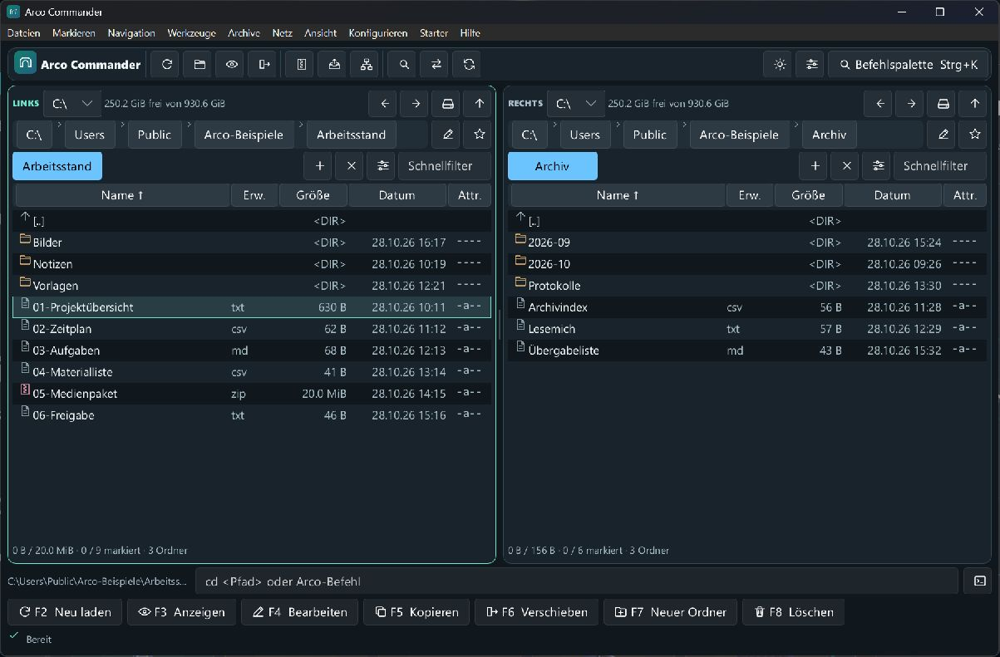
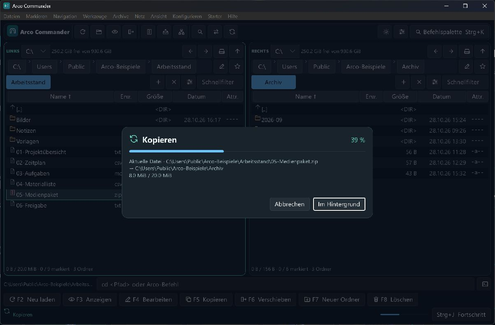
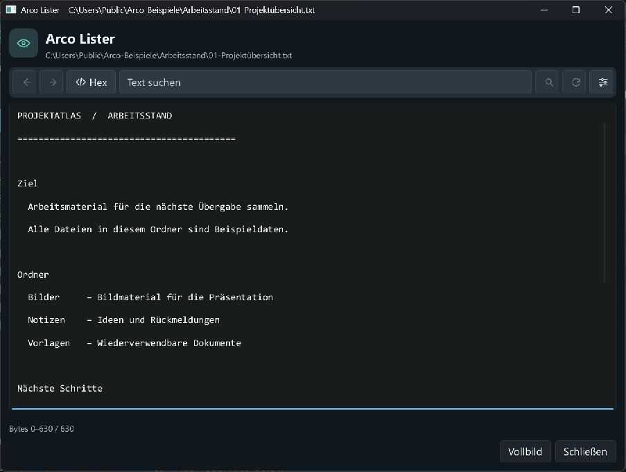

# 

Arco Commander ist ein Zwei-Fenster-Dateimanager für Windows, geschrieben in Rust und inspiriert von Norton Commander und Total Commander. Die Desktop-Oberfläche verwendet Slint.

[](https://github.com/Mucumba77/arco-commander/releases/latest)
[](https://github.com/Mucumba77/arco-commander/actions/workflows/windows-ci.yml)
[](LICENSE)
[](https://slint.dev/)

## Download

[**Arco Commander 1.0.0 für Windows x64 herunterladen**](https://github.com/Mucumba77/arco-commander/releases/download/v1.0.0/arco-commander-v1.0.0-windows-x64.zip)

Das portable ZIP ist für Windows 10 22H2 und Windows 11 vorgesehen. Entpacke es vollständig und starte `arco-commander.exe`. Das Paket enthält beide Plugin-Hosts, das ZIP-SFX-Modul, die Kurzanleitung und Drittanbieterhinweise. Es ist unsigniert. [Release-Hinweise und SHA-256-Prüfsumme](https://github.com/Mucumba77/arco-commander/releases/tag/v1.0.0)

Für ein Update entpacke die neue Version in einen eigenen Ordner. Arco verwendet das bisherige Standardprofil weiter. Bei Verwendung von `--portable` übernimm zusätzlich die Profildatei `arco-commander.json` aus dem bisherigen Programmordner.



## Schnellstart

1. Lade das Windows-x64-ZIP herunter, entpacke es vollständig und starte `arco-commander.exe`.
2. Öffne links deinen Quellordner und rechts den Zielordner. Ein Doppelklick öffnet einen Ordner. Mit `Tab` wechselst du die aktive Seite.
3. Wähle im Quellordner eine Datei und drücke `F5`. Prüfe das vorgeschlagene Ziel im anderen Dateifenster und bestätige mit **Kopieren**.
4. Mit `F3` zeigst du die fokussierte Datei an. Mit `Strg+K` öffnest du die Befehlspalette und findest weitere Aktionen samt Tastenkürzel.

## Einblicke

### Kopierfortschritt

Die Fortschrittskarte zeigt die aktuelle Datei und den Stand der Kopie. Über **Im Hintergrund** arbeitest du in den Dateifenstern weiter.



### Lister

Mit **Eigenes Fenster** öffnest du die Dateivorschau im separaten Lister. Dort kannst du im Text suchen oder zur Hexansicht wechseln.



## Bedienung und Funktionen

Die Menüleiste gruppiert Hauptaktionen und verwandte Befehle in Untermenüs. Symbole und aktuell belegte Tastenkürzel stehen direkt am Befehl. Die **Befehlspalette** in der Werkzeugleiste und unter **Werkzeuge** öffnet sich standardmäßig mit `Strg+K`. Sie filtert nach Befehlsnamen, Tastenkürzeln und unterstützten `cm_`-Aliasen. Mit Pfeiltasten und Enter führst du einen Treffer aus.

Kopieren, Verschieben und Archivaufträge öffnen eine Fortschrittskarte. Lokale Dateikopien zeigen den Stand der aktuellen Datei. Beim regulären ZIP-Pack- und Entpackvorgang zeigt der Balken den Stand der unkomprimierten Daten. Aufträge ohne messbare Gesamtmenge zeigen einen animierten Balken. **Im Hintergrund** blendet die Karte aus. Über **Fortschritt** in der Statusleiste oder `Strg+J` öffnest du sie wieder. Konflikt- und Anmeldedialoge erscheinen vor der Karte.

Die Masken für Kopieren, Verschieben und Packen zeigen Quelle und Ziel vor dem Start. Zielmasken und gespeicherte Suchfilter stehen bei Transfers unter **Erweiterte Optionen**. Im Transfermanager sind der aktuelle und die wartenden Aufträge getrennt. Wähle einen wartenden Eintrag aus, um seine Reihenfolge zu ändern oder ihn zu entfernen.

Die interne Vorschau und der separate Lister verwenden dieselbe Werkzeugleiste für Text und Hex. Die Lupe setzt die Suche fort. Kodierung, Zeilenumbruch und Byte-Offset stehen unter **Anzeigeoptionen**. Bilder lassen sich einpassen oder in Originalgröße betrachten.

Unter **Konfigurieren → Einstellungen → Allgemein** stehen Deutsch, Englisch und Französisch zur Auswahl. Die Sprache wird im Profil gespeichert. Einige Fachdialoge und Meldungen verwenden weiterhin Deutsch.

Die Oberfläche hat zwei kompakte, virtualisierte Dateilisten mit getrennten Spalten für Name, Erweiterung, Größe, Datum und Attribute. Die sortierte Spalte zeigt ihre Richtung an. Laufwerk und Speicherplatz stehen oberhalb der anklickbaren Pfadsegmente. `[..]` führt in den Elternordner und gehört nie zu einer Dateiauswahl. Das Verhältnis der beiden Fenster lässt sich an der Trennlinie ziehen und wird im Profil gespeichert.

Die Dateiliste verwendet standardmäßig Segoe UI Regular mit 14 logischen Pixeln. Unter **Einstellungen → Schrift** lassen sich Segoe UI, Arial und Verdana sowie 12, 14, 16 oder 18 Pixel auswählen. Zeilenhöhe und Detailspalten passen sich der Schriftgröße an.

`Strg+F1` schaltet auf Kurzansicht, `Strg+F2` auf Detailansicht und `Strg+Umschalt+F1` auf Miniaturansicht. In lokalen Ordnern lädt Arco sichtbare BMP-, GIF-, JPEG-, PNG- und WebP-Bilder im Hintergrund. Für Dateien ohne eingebaute Vorschau kann ein aktiviertes WLX-Plugin mit passender Dateimaske eine Miniatur liefern. Arco verarbeitet ANSI- und Unicode-Exporte im jeweiligen 32- oder 64-Bit-Plugin-Host. Ohne verfügbares Vorschaubild erscheint ein Dateisymbol. Beim Neuladen des Ordners und bei Änderungen an der Plugin-Verwaltung wird der Cache verworfen. Die Ansicht wird pro Tab gespeichert. [Total-Commander-Befehlsreferenz](https://www.ghisler.ch/wiki/index.php?title=List_of_internal_commands), [WLX-SDK](https://www.ghisler.com/plugins.htm)

`Strg+F8` schaltet den Ordnerbaum im aktiven lokalen Dateifenster ein oder aus. Er beginnt im aktuellen Ordner und lädt einen Ast beim Aufklappen im Hintergrund. Mit den Pfeiltasten wechselst du den Eintrag oder klappst einen Ast auf und zu. Doppelklick oder Enter öffnet den Ordner in der darunterliegenden Dateiliste. Ein Klick auf die Dateiliste gibt ihr wieder den Tastaturfokus. [Total-Commander-Befehlsreferenz](https://www.ghisler.ch/wiki/index.php?title=List_of_internal_commands)

`Strg+Umschalt+F8` wechselt zwischen ausgeblendeten Bäumen, einem gemeinsamen Baum für das gerade aktive Dateifenster und je einem Baum pro Fenster. Diese Bäume beginnen am Windows-Desktop. Doppelklick oder Enter öffnet auch virtuelle Shell-Ordner im Arco-Dateifenster. **Ansicht → Windows-Desktop im Dateifenster** und **Ansicht → Dieser PC im Dateifenster** öffnen sie direkt. Shell-Ordner unterstützen den Tab-Verlauf, Pfadsegmente und das Windows-Kontextmenü für den angeklickten Eintrag. Physische Ordner wechseln in die normale Dateiansicht. Arco speichert die Shell-Adressen im eigenen Profil. [Windows-Shell-Namensraum](https://learn.microsoft.com/en-us/windows/win32/shell/navigate)

Windows-Shell-Tabs unterstützen Kopieren, Verschieben, Umbenennen, Ordner anlegen und Löschen über den Transfermanager. Arco übergibt die Shell-Einträge an Windows, auch wenn sie keinen lokalen Dateipfad haben. Welche Aktionen verfügbar sind, bestimmt der Shell-Anbieter. Windows behandelt Konflikte und entscheidet über die Verfügbarkeit des Papierkorbs. [Windows-Dateioperationen](https://learn.microsoft.com/en-us/windows/win32/api/shobjidl_core/nn-shobjidl_core-ifileoperation)

Das Hauptmenü und die Symbolleiste gruppieren die häufigen Aktionen. `Alt+D` öffnet die Pfadeingabe, `Strg+D` die Ordnerfavoriten und `Strg+S` den Schnellfilter. `Strg+Q` zeigt Text, Hexdaten oder ein Bild zur fokussierten Datei im gegenüberliegenden Fenster. `Strg+Umschalt+L` setzt den Fokus in die Befehlszeile. Dort funktionieren `cd <Pfad>`, Arco-Befehle aus `Strg+K` und die unterstützten `cm_`-Aliase. Die klassische Funktionsleiste reicht von `F2` bis `F8`. Kopieraufträge laufen im Hintergrund und melden Konflikte.

`Strg+Umschalt+S` springt zum nächsten sichtbaren Treffer und behält Filter und Markierungen bei. Die Schnellsuche bietet Namensanfang, Teiltreffer und regulären Ausdruck. Im Schnellfilter aktiviert ein führendes `~` reguläre Ausdrücke. Unter **Markieren** lässt sich die Auswahl in einer neuen Textdatei speichern und aus einer Dateiliste oder der Zwischenablage laden. Jede Zeile enthält einen Namen oder Pfad.

Unter **Einstellungen → Bedienung** legst du fest, ob die Schnellsuche zusätzlich beim Tippen oder mit `Alt` beziehungsweise `Strg+Alt` und einem Buchstaben oder einer Ziffer öffnet.

**Ansicht → Spaltensätze** oder `Umschalt+F1` legt einen Satz pro Tab fest. Neben Name, Erweiterung, Größe, Datum, Attributen und Kommentar lassen sich zuvor registrierte WDX-Felder mit eigener Überschrift und Breite einfügen. **Ansichtsmodi** speichern Ansicht, Spaltensatz und Sortierung. Der TC-INI-Import übernimmt unterstützte Modi, darunter unveränderte Ansicht und Tab- und Listenfarben für helle und dunkle Darstellung. Er übernimmt auch unterstützte Spaltensätze mit Titel, Breite und Ausrichtung. Native Spaltenausdrücke unterstützen Literale, bedingten Text, Zeichenbereiche und Größen- und Datumsformate. WDX-Felder benötigen ein aktiviertes, passendes Plugin. In einem WFX-Fenster öffnet **Ansicht → Spaltensätze** die Sätze des aktiven WFX-Plugins. Wenn das Plugin Inhaltsfelder anbietet, können diese mit ihrer Einheit als eigene Spalten eingerichtet und über die Spaltenköpfe sortiert werden. Die Werte sichtbarer Zeilen lädt Arco im Hintergrund. Eine vom Plugin angebotene Standardansicht wird automatisch geladen. Eigene Sätze und die ausdrücklich gewählte Arco-Standardansicht haben Vorrang. Die Mehrfachsortierung kombiniert Plugin-Spalten mit eingebauten Feldern. Ein Eintrag wie wfx1 verwendet die Sortierrichtung des Plugins. +wfx1 und -wfx1 legen sie ausdrücklich fest. Für benutzerdefinierte Tabs aus Total Commander importiere zuerst die Ansichten aus dem zugehörigen `wincmd.ini`. Arco kann eigene native Spaltensätze und die Sortierung direkt in exportierten `.tab`-Dateien mitgeben. Beim Import wird ein abweichender gleichnamiger Satz unter einem neuen Namen gespeichert. Unter **Konfigurieren → Automatische Ansichtsregeln** gilt die erste passende Regel. Zum Beispiel wählt `Fotos | lokal | C:/Medien/** | *.jpg;*.png | *.raw` den Modus **Fotos** für passende Ordner. Beim Verlassen des Bereichs wird die gespeicherte manuelle Ansicht des Tabs wieder aktiv. **Konfigurieren → Datei- und Auswahlfarben** bietet eigene Hell- und Dunkelwerte nach Maske sowie für Auswahl und Cursor. [Total-Commander-Spaltensätze](https://ghisler.ch/wiki/index.php?title=Custom_columns)

In **Mehrfachsortierung** kombinierst du Standardfelder und WDX-Spalten, etwa `erweiterung, -wdx1, name`. `wdx1` bezeichnet die erste WDX-Spalte der Ansicht. Ansichtsregeln akzeptieren zwei zusätzliche Felder. `Fotos | laufwerk | C:/Medien/** | *.jpg;*.png | | und | 50` verlangt einen passenden Pfad und mindestens 50 Prozent Bilder unter den Dateien im Ordner.

**Ansicht → Dateitypen im Tab filtern** speichert Masken wie `*.txt *.md | alt*` pro Tab. Ordner bleiben sichtbar. **Alle Dateien anzeigen** löscht den Filter. Der `.tab`-Austausch übernimmt den Dateitypfilter und zusätzliche Standard-Sortierspalten.

**Konfigurieren → TC-Ansichten importieren** liest `[ViewModes]` und `[ViewModeSwitch]` aus einer `wincmd.ini`. Die Vorschau nennt übernommene Modi und Regeln sowie ausgelassene Optionen. Importierte Regeln folgen den vorhandenen Regeln. In der Regelbearbeitung bleiben sie als `TC | Modus | Regel` editierbar. `|&` hat Vorrang vor `||`. Unterstützt sind Ordnerarten, Pfadmasken und die vier Dateibedingungen für alle, keine, mindestens die Hälfte oder mindestens einen Treffer. [TC-Herstellerhilfe](https://www.totalcommander.ch/help/tcmdd1158_chm.zip)

**Ansicht → Nur markierte Einträge umschalten** schränkt das aktive Dateifenster auf die beim Einschalten markierten Einträge ein. Der Elternordner bleibt erreichbar. Die Ansicht endet beim erneuten Aufruf, beim Ordnerwechsel oder wenn eine Suche oder Zweigansicht die Liste ersetzt. In der Befehlszeile funktionieren auch `cm_ShowOnlySelected` und `2023`. [Total-Commander-Befehlsreferenz](https://www.ghisler.ch/wiki/index.php?title=List_of_internal_commands)

`Alt+F1` öffnet die linke und `Alt+F2` die rechte Laufwerkswahl. Wähle mit Pfeiltasten und Enter oder tippe den Laufwerksbuchstaben. In der Dateiliste wählt ein Linksklick den Eintrag aus. Doppelklick und `Enter` öffnen Dateien und Ordner. `Strg`-Klick markiert einzeln und `Umschalt`-Klick markiert einen Bereich. Rechtsklick und `Umschalt+F10` öffnen bei lokalen Dateien das klassische Windows-Kontextmenü. Beim Rechtsklick auf eine markierte Datei gilt das Menü für die markierte Auswahl im selben Ordner.

**Ansicht → Windows-Ordner öffnen** zeigt die von Windows verwalteten Pfade für Desktop, Dokumente, Downloads und weitere Benutzerordner. **Netz** bietet die Windows-Dialoge zum Verbinden und Trennen von Netzlaufwerken. **Hilfe** öffnet bei Bedarf die Windows-Systeminformationen oder den Versionsdialog. [Windows-Ordner](https://learn.microsoft.com/windows/win32/shell/known-folders), [Netzlaufwerkdialoge](https://learn.microsoft.com/en-us/windows/win32/wnet/using-the-connections-dialog-box)

**Ordnerfavoriten** kann Gruppen mit Untergruppen sowie einen optionalen Ordner für das zweite Dateifenster speichern. Der Import aus `wincmd.ini` übernimmt passende `[DirMenu]`-Einträge mit ihren Titeln, lokalen Pfaden und Gruppen. Er löst auf beiden Seiten unter anderem `%COMMANDER_PATH%`, `%COMMANDER_DRIVE%`, `%USERPROFILE%` und `%$PERSONAL%` auf. Für `%COMMANDER_PATH%` sucht Arco nach der ausführbaren Datei neben der INI und verwendet danach die Umgebung oder die registrierte Installation. **Netz → Lokale Windows-Freigaben** zeigt lokale SMB-Freigaben. Für neue Freigaben wählst du Lesen, Ändern oder Vollzugriff und kannst bis zu 32 Windows-Konten, Gruppen oder SIDs durch Semikolon getrennt angeben. Ein leeres Feld verwendet das aktuelle Konto. Mit `Konto=Lesen`, `Konto=Ändern` oder `Konto=Vollzugriff` kannst du das gewählte Standardrecht für einzelne Einträge überschreiben. Die Dateisystemrechte gelten zusätzlich. **Dateien → Datenträgerbezeichnung ändern** zeigt den ausgewählten lokalen Datenträger vor der Änderung an. [Total-Commander-Verzeichnisliste](https://ghisler.ch/wikide/index.php?title=Verzeichnisliste), [TC-Pfadvariablen](https://www.ghisler.ch/wikide/index.php/Navigation), [Windows-Freigaben](https://learn.microsoft.com/en-us/windows/win32/netshare/network-share-functions)

`↑` und `↓` bewegen den Cursor in der Dateiliste. Mit `Rücktaste` oder `Strg+Bild↑` wechselst du zum Elternordner. Wiederholte Rücktasten überspringen noch laufende Ladevorgänge und wechseln zum zuletzt angeforderten Elternordner.

Über das Zahnrad neben der Tab-Leiste lässt sich der aktive Ordner-Tab benennen, duplizieren, umordnen oder ins andere Dateifenster kopieren und verschieben. Ein fest gesperrter Tab öffnet Ordnerwechsel in einem neuen Tab. Die Sperre mit erlaubtem Ordnerwechsel kehrt beim Aktivieren oder über die Schaltfläche für den Stammordner zur gespeicherten Basis zurück. `Strg+Umschalt+A` öffnet die Tab-Liste. **Ansicht → Tab-Gruppen verwalten** speichert benannte Gruppen für beide Dateifenster und lädt sie durch Anhängen oder Ersetzen. Bei FTP- und Archiv-Tabs speichert das Profil den lokalen Ersatzordner.

In **Ansicht → Tab-Gruppen verwalten → Total-Commander-Datei importieren** kannst du eine `.tab`-Datei als Gruppe speichern. Arco ordnet `[activetabs]` der beim Start des Imports aktiven Seite zu und `[inactivetabs]` der anderen Seite. Die Vorschau zeigt Pfade, Titel, den aktiven Tab und unterstützte Sperren. Der Austausch umfasst Kurz- und Detailansicht sowie die Standardsortierung und ihre Richtung. Unterstützt werden lokale Ordner, Shell-Adressen, Ordner in erkennbaren vorhandenen Archiven, WFX-Pfade und FTP-Pfade mit Profilnamen. Weitere Optionen und übersprungene Einträge werden gezählt. Beim Ersetzen bleiben Seiten ohne importierte Tabs erhalten. [Total-Commander-Hilfe und FAQ](https://www.ghisler.com/dfaq.htm)

Im selben Dialog übernimmt eine `.ini`-Datei die Abschnitte `[LeftTabs]` und `[RightTabs]` auf ihren jeweiligen Seiten. `RedirectSection` und `AlternateUserIni` können auf reguläre lokale `.ini`- oder `.tab`-Dateien verweisen. Relative Referenzen beginnen im Ordner der gewählten Datei. Pfadvariablen wie `%COMMANDER_INI_PATH%` werden aufgelöst. Arco folgt einer Auslagerung pro Abschnitt und meldet fehlende oder weitere Verweise. [TC-Änderungshistorie zu INI-Abschnitten](https://ghisler.ch/wiki/index.php?title=List_of_changes_%28version_6.56_-_7.0%29)

Ein gespeicherter WFX-Pfad braucht ein aktiviertes Plugin mit passendem Namen. Für einen gespeicherten FTP-Pfad brauchst du ein gleichnamiges Arco-FTP-Profil. Wenn noch keine passende Sitzung besteht, öffnet `Enter` auf dem Tab die Verbindung. Arco exportiert weder FTP-Benutzernamen noch Passwörter. [TC-Format für FTP-Tabs](https://ghisler.ch/board/viewtopic.php?t=27260)

**Ansicht → Ordner-Tabs als .tab exportieren** speichert die offenen Tabs beider Seiten oder einer einzelnen Seite. Gespeicherte Gruppen haben denselben Export in ihrem Gruppenmenü. Arco schreibt UTF-16LE und erwartet einen neuen Dateinamen. Die Befehlszeile unterstützt `SAVETABS`, `SAVETABSL`, `SAVETABSR`, `SAVETABS2`, `SAVETABS2L` und `SAVETABS2R` mit einer `.tab`-Datei als Argument. Zum Laden dienen `OPENTABS` und `APPENDTABS`, jeweils auch mit `L` oder `R` für die Seite, die `[activetabs]` erhalten soll.

Im Menü **Ansicht** lassen sich markierte lokale Ordner als Hintergrund-Tabs auf beiden Seiten öffnen. **Kürzlich geschlossene Tabs** zeigt die letzten 20 einzeln geschlossenen Tabs der laufenden Sitzung und öffnet sie auf ihrer ursprünglichen Seite.

**Konfigurieren → Einstellungen** bündelt Sprache und Farbschema, Layout, Bedienung, Tastatur, Schrift, Dateiübertragung und externe Programme. Die direkten Menüeinträge für Sprache, NTFS-Kopieroptionen, Editor und Everything öffnen die jeweilige Einstellungsseite. Im Layout lassen sich die obere und mittlere Symbolleiste, Laufwerksbuttons und Laufwerksliste, Pfad, Verlauf und Spaltenüberschriften separat ein- und ausblenden. `Alt+D` öffnet die Pfadeingabe auch bei ausgeblendetem Pfad. Unter Bedienung lässt sich einstellen, ob die Ziffernblock-Auswahl Ordner einbezieht.

Unter **Konfigurieren → Eigene Buttonbars** bearbeitest du die obere oder mittlere Leiste. Eine Schaltfläche enthält Beschriftung, Symbol und einen Arco-Befehl, einen unterstützten `cm_`-Aufruf oder einen absoluten EXE-Pfad. Beim Symbol kannst du auch den absoluten Pfad einer Bilddatei bis 1 MiB eintragen. Für eine EXE steht jedes Argument auf einer eigenen Zeile. Das separate Feld **Startordner** akzeptiert einen absoluten Pfad oder einen Pfad relativ zum Quellordner. Beim `.bar`-Import werden Pfadvariablen in EXE- und Startpfaden aufgelöst. Die Leisten übernehmen die gespeicherte Reihenfolge. Eine leere Liste zeigt die Standardbelegung. [Total-Commander-Buttonbar](https://ghisler.ch/wiki/index.php?title=Button_bar)

Mit `Untermenü` als Befehl legst du eine verschachtelte Leiste an. Über **Einträge im Untermenü bearbeiten** fügst du ihr Schaltflächen oder weitere Untermenüs hinzu. Beim Import übernimmt Arco lokale `.bar`-Verweise und `OPENBARMENU`-Einträge. Die Vorschau zeigt die obersten Schaltflächen und zählt ausgelassene Einträge. Der Export schreibt UTF-16LE und legt referenzierte Untermenüs in einem Unterordner neben der Hauptdatei ab. Die Hauptdatei enthält deren absolute Pfade. [Total-Commander-Buttonbar](https://ghisler.ch/wiki/index.php?title=Button_bar)

`Leistenwechsel` ersetzt vorübergehend die aktuelle Leiste. Der erste Button führt zur vorherigen Leiste zurück. Der `.bar`-Austausch unterstützt `OPENBAR`, `OPENBAR1`, `OPENBAR2` und deren Parameter `*` für die Standardleiste. Als Symbol kannst du Ressourcen aus EXE-, DLL- und ICL-Dateien angeben. Ein Index ab 0 wählt die Position, ein negativer Wert die Ressourcen-ID. [Total-Commander-Buttonbar](https://ghisler.ch/wiki/index.php?title=Button_bar)

Für einen EXE-Pfad schalten `min:` und `max:` den Startmodus um. Mit `tc:`, `tc-min:` und `tc-max:` werden `%P`, `%T`, `%N`, `%M`, `%O`, `%E` und `%%` in den Argumenten aufgelöst. `%P%N` ergibt beispielsweise den vollständigen Pfad des fokussierten Eintrags. Der `.bar`-Austausch übernimmt die Startmodi und diese Platzhalter. In einem WFX-Dateifenster liefert `%v` den virtuellen Namen des fokussierten Eintrags und `%V` den vollständigen virtuellen Pfad mit Pluginname. Ein führendes `?` in den importierten EXE-Parametern zeigt die aufgelösten Argumente zur Prüfung an. In Arco legst du solche Schaltflächen mit `tc-ask:`, `tc-min-ask:` oder `tc-max-ask:` vor dem EXE-Pfad an. `%S`, `%R`, `%P%S` und `%T%R` übergeben die markierten lokalen Einträge als einzelne Argumente. Eine nachgestellte Zahl wie `%P%S3` begrenzt die Auswahl auf die ersten drei. `%S+2-4` übernimmt die zweite bis vierte Position. `%R-3-` übergibt die letzten drei Einträge der Gegenseite. `%UL` erzeugt eine UTF-8-Liste mit Pfaden, `%WF` eine UTF-16LE-Liste mit Dateinamen. Mit `%a%UL` kommen die markierten Einträge der Gegenseite hinzu. `%X` wechselt zu linker und rechter Seite, `%x` zurück zu Quelle und Ziel. Weitere unterstützte Varianten sind 8.3-Namen, Teilstrings und Präfixe und Suffixe für ausgewählte Dateien. Die Liste bleibt während der Laufzeit des gestarteten Programms verfügbar, solange Arco geöffnet ist. [Total-Commander-Buttonbar](https://ghisler.ch/wiki/index.php?title=Button_bar)

**Starter** verwendet denselben Editor für benannte Programme und Arco-Befehle. **Konfigurieren → Buttonbar- und Startervorlagen** speichert beide Leisten und das Startermenü unter einem Namen. Unter **Einstellungen** kannst du das helle, dunkle oder das Windows-Farbschema wählen.

Unter **Tastatur** wählst du einen Befehl, klickst auf **Tastenkürzel aufzeichnen** und drückst die Kombination. **Zuweisen** ergänzt eine Belegung. Bei einem Konflikt zeigt Arco den bisherigen Befehl an und bietet **Belegung ersetzen** an. Einzelne Belegungen lassen sich entfernen. **Standardbelegung laden** setzt alle Kürzel im Entwurf zurück. **Anwenden** oder **OK** speichert die Änderungen im Profil. Systemtasten wie `Alt+F4` sowie `Esc` und das alleinige `F10` behalten ihre Bedienfunktion.

Die Standardbelegung folgt bei `Alt+←/→` dem Ordnerverlauf. `Num +` und `Num −` erweitern beziehungsweise verkleinern die Auswahl nach Maske. `Num *` kehrt die Auswahl um und `Num /` stellt die vorherige Auswahl wieder her. `Alt+Num +/−` arbeitet mit der Erweiterung der Datei unter dem Cursor.

`Strg+Umschalt+B` zeigt markierte lokale Dateien und alle Dateien in den markierten Ordnern in einer Liste. Erneutes Drücken kehrt zur Ordneransicht zurück. [Total-Commander-Funktionsbeschreibung](https://www.ghisler.ch/board/viewtopic.php?t=26819)

`Strg+L` zeigt die logische Größe der lokalen Auswahl und den von ihren Dateidaten belegten Speicher. Windows liefert die Belegung komprimierter und dünn belegter Dateien. Hardlinks zählen für den belegten Speicher einmal. Bei Abfragefehlern kennzeichnet der Dialog die Teilsumme. `Alt+Umschalt+Enter` trägt die logischen Größen der sichtbaren Ordner in die Größenspalte ein. `Esc` bricht die Berechnung bei fokussierter Dateiliste ab. [Total-Commander-Befehlsreferenz](https://www.ghisler.ch/wiki/index.php?title=List_of_internal_commands)

`Strg+Umschalt+F2` zeigt die Kommentare eines Ordners aus `descript.ion`. `Strg+Z` bearbeitet den Kommentar des fokussierten Eintrags. **Dateien → Attribute und Zeitstempel ändern** setzt oder entfernt R, H, S und A und kann die Auswahl rekursiv bearbeiten. Dateilisten und Textdateien lassen sich über **Dateien** mit Vorschau drucken. Der Lister bietet ebenfalls Textdruck an. [Ghisler zu descript.ion](https://www.ghisler.ch/board/viewtopic.php?p=355053), [Windows-Druckdialog](https://learn.microsoft.com/en-us/windows/win32/api/commdlg/ns-commdlg-printdlgw)

Im Menü **Dateien** lassen sich Namen, Pfade und Details der Dateiauswahl als Text kopieren. Die Detailansicht gibt Name, Erweiterung, Größe, Datum, Attribute und aktive WDX-Spalten als tabulatorgetrennte Werte aus.

Markiere die gewünschten Zielordner in einem lokalen Dateifenster. Wähle im anderen Fenster die Quelldateien und Ordner aus und öffne **Dateien → In markierte Zielordner kopieren**. Die Vorschau listet alle Ziele auf. Arco löst markierte Verzeichnislinks auf, verarbeitet jeden Zielordner einmal und prüft Überschneidungen vor der ersten Kopie. Ignorierliste, Konfliktregel und Abbruch gelten für den gesamten Auftrag.

Beim lokalen Kopieren mit `F5` und Verschieben mit `F6` kannst du den vorhandenen Zielordner ändern und eine Zielmaske eintragen. Relative Pfade gehen vom vorgeschlagenen Ordner aus. `*.bak` ändert die Erweiterung und `*-Kopie.*` hängt Text an den Namen an. `?` übernimmt das Zeichen an seiner Position und `*` die verbleibenden Zeichen. Arco prüft Namen und Kollisionen, bevor es mit dem Auftrag beginnt. [Total-Commander-Referenz zu Zielmasken](https://ghisler.ch/board/viewtopic.php?p=204785)

F5 und F6 bieten gespeicherte lokale Suchfilter sowie Regeln für gleichnamige Zieldateien. Dazu gehören Überspringen, Überschreiben, Überschreiben nach Datum oder Größe und ein freier Zielname. F5 kann außerdem an den bisherigen Zielinhalt anhängen. **Dateien → Transfermanager** zeigt lokale Aufträge, FTP- und FXP-Transfers, Kopien über Archivfenster und Plugin-Mehrfachaufträge in einer Warteschlange. Reihenfolge, Abbruch und optionales Protokoll gelten für diese Transfers. Pause, Geschwindigkeitslimit und erneuter Kopierversuch stehen für geeignete lokale Aufträge zur Verfügung. Mit **Dateikommentare mitführen** steuert der Transfermanager die Übernahme von `descript.ion`-Kommentaren bei lokalen Transfers.

Standardmäßig öffnet ein Dateikonflikt einen Dialog mit Pfad, Größe, Zeitstempel, Schreibschutz und Text- oder Hexvorschau für beide Seiten. Die Entscheidung gilt für diese Datei oder optional für alle folgenden Konflikte. Wenn sich die Zieldatei inzwischen geändert hat, meldet Arco beim Überschreiben einen Fehler.

Bei lokalen Zielen kannst du einen eigenen Dateinamen eingeben. Arco prüft den Namen und veröffentlicht die Datei nur, wenn der Name im Zielordner frei ist. Beim Entpacken aus einem Archivfenster und bei WFX-Downloads steht derselbe Dialog zur Verfügung. FTP-Kopien fragen bei vorhandenen Zieldateien nach der FTP-Übersicht. Bei FTP-Kopien in beide Richtungen und zwischen Servern sowie bei beschreibbaren ZIP- und 7z-Zielen lässt sich der Quellinhalt an die Zieldatei anhängen. Der Inhalt wird vor der Veröffentlichung temporär zusammengesetzt.

Bei WFX-Zielen kannst du überspringen, unter einem freien Namen speichern oder eine einzelne Datei überschreiben. Für das Überschreiben benötigt das Plugin die jeweiligen Kopier-, Umbenenn- und Löschoperationen. Arco bereitet die neue Datei unter einem Zwischennamen vor und prüft Größe, Änderungszeit und Attribute der bisherigen Zieldatei vor der Veröffentlichung. Falls die Veröffentlichung scheitert, versucht Arco die bisherige Zieldatei wiederherzustellen und nennt im Fehlerfall die relevanten Sicherungs- und Zwischenpfade. Für kleine FTP-, WFX- und Archiveinträge bis 64 KiB kann der Dialog eine Text- oder Hexvorschau laden. [WFX-SDK](https://www.ghisler.com/plugins.htm)

Unter **Konfigurieren → Einstellungen → Dateiübertragung** legst du für neue lokale F5- und F6-Aufträge getrennt fest, ob Arco benannte Datenströme, Quell-DACL, Besitzer, Überwachungs-ACL, Hardlink-Gruppen, Sparse-Bereiche und die Erstellungszeit übernimmt. DOS-Attribute werden für Dateien und neu angelegte Ordner übernommen. Die Option **Ausgewählte Verzeichnisjunctions als Links kopieren** gilt für F5 zu einem lokalen Zielordner mit freiem Zielnamen. Sie kopiert direkt ausgewählte Junctions zu lokalen Laufwerkspfaden, ohne deren Zielverzeichnis zu durchlaufen. Zusätzliche Metadatenoptionen für Datenströme, Rechte, Besitzer, Überwachungs-ACL und Erstellungszeit gelten für reguläre Kopien. Arco setzt kopierte ACLs geschützt, damit Zielvererbung ihren Inhalt nicht ändert. Verschieben per nativer Umbenennung behält die vorhandenen Dateimetadaten. [Windows-Dateiströme](https://learn.microsoft.com/en-us/windows/win32/fileio/file-streams), [Sparse-Dateien](https://learn.microsoft.com/en-us/windows/win32/fileio/sparse-files)

Für Überwachungs-ACLs benötigt der Auftrag `SeSecurityPrivilege`. Beim Setzen eines fremden Besitzers kann Windows `SeRestorePrivilege` verlangen. Fehlt ein erforderliches Recht, meldet Arco den Fehler im Transferbericht. Bei Dateiübertragungen wird die vorbereitete Kopie erst nach erfolgreicher Übernahme der gewählten Sicherheitsdaten veröffentlicht. [SACL-Zugriffsrecht](https://learn.microsoft.com/en-us/windows/win32/secauthz/sacl-access-right), [Windows-Privilegien](https://learn.microsoft.com/en-us/windows/win32/secauthz/privilege-constants)

Unter **Konfigurieren → Interne Dateizuordnungen** hinterlegst du Masken, Aktionen und Programme. Die erste passende Standardaktion gilt beim Öffnen in Arco. **Dateien → Interne Dateiaktionen** bietet alle passenden eigenen Verben an. **Mit Windows öffnen** und **Öffnen mit** rufen die Windows-Zuordnung auf. Im Dateimenü stehen außerdem die Windows-Aktionen für Administrator, anderen Benutzer und `.lnk`-Verknüpfungen bereit. [Windows-Shell-Verben](https://learn.microsoft.com/en-us/windows/win32/shell/launch)

Unter **Dateien → Dateiauftrag mit Windows-Rechteabfrage** kannst du einen einzelnen Auftrag im lokalen oder Windows-Shell-Dateifenster auswählen. Falls er höhere Rechte benötigt, kann Windows für diesen Auftrag die Benutzerkontensteuerung anzeigen. [Windows-Optionen für Dateioperationen](https://learn.microsoft.com/en-us/windows/win32/api/shobjidl_core/nf-shobjidl_core-ifileoperation-setoperationflags)

`Alt+F7` öffnet die erweiterte lokale Suche. Sie unterstützt mehrere Suchorte, eine markierte Auswahl, Masken und Ausschlüsse, reguläre Ausdrücke, Text mit Kodierungswahl, Hexdaten, Größe, Datum, Attribute und Ordnertiefe. Benannte Profile stehen auch als lokale Transferfilter zur Verfügung. Die Suchergebnisse lassen sich als Dateiliste übernehmen. Unter **Konfigurieren → Everything-Suche** kann der absolute Pfad zur optionalen `es.exe` hinterlegt werden. `ev:` fragt den globalen Index ab und `ed:` beschränkt die Abfrage auf die Suchorte. Einfache Suchmuster können bei fehlendem Index mit der internen Suche laufen. [Total-Commander-Suche](https://ghisler.ch/wiki/index.php?title=Search), [Everything CLI](https://www.voidtools.com/support/everything/command_line_interface/)

`Alt+Umschalt+F7` öffnet dieselbe Suche in einem eigenen Fenster. Der Suchlauf arbeitet in einem separaten Prozess und kann unabhängig von Dateioperationen abgebrochen werden. Beide Dateifenster bleiben bedienbar. Die Treffer lassen sich ins ursprüngliche Dateifenster übernehmen, solange dessen Ansicht gleich geblieben ist.

Ein Suchprofil lässt sich im lokalen Ordner und in einem geöffneten Archiv laden. **WDX-Feldbedingungen** verknüpft ein zuvor gespeichertes WDX-Suchprofil mit den übrigen Bedingungen. Wenn Arco einzelne Einträge aus dem Archiv entpacken kann, stellt es Kandidaten für die Inhalts- und WDX-Prüfung bis 64 MiB temporär bereit. Suchorte im Archiv sind relativ zum geöffneten Archivordner. Ein eingegebenes Archivpasswort gilt für den Suchlauf. Der Index von Everything und die lokalen Transferfilter verwenden ihre eigenen unterstützten Kriterien.

Über **Dateien → Dateien kodieren** und **Dateien → Dateien dekodieren** verarbeitest du UUE, XXE und MIME. Arco schreibt die Ergebnisse in den lokalen Ordner gegenüber. Bei einem aufgeteilten UUE- oder XXE-Block wählst du den ersten Teil, etwa `datei001.uue` oder `dateiaa`. Die nummerierten oder alphabetisch benannten Folgeteile müssen im selben Ordner liegen. Ohne erkennbare Endung wählst du das Format ausdrücklich. MIME verwendet Base64 und unterstützt beim Dekodieren bis zu 64 MiB große mehrteilige Nachrichten. BinHex 4.0 legt einen vorhandenen Mac-Ressourcenzweig als `.rsrc` ab. Arco prüft Dateinamen und schreibt ausschließlich neue Zieldateien. [TC-Herstellerhilfe](https://www.totalcommander.ch/help/tcmdd1158_chm.zip), [MIME-Base64](https://www.rfc-editor.org/rfc/rfc2045.html), [BinHex 4.0](https://www.rfc-editor.org/rfc/rfc1741.html)

Für `message/partial` markierst du alle Fragmente und wählst MIME beim Dekodieren. Arco prüft die Teilnummern, fügt passende Nachrichten bis 64 MiB zusammen und schreibt anschließend die Anhänge. [MIME-Nachrichtenteile](https://www.rfc-editor.org/rfc/rfc2046#section-5.2.2)

Mit **Ansicht → Nur Programme anzeigen** (`Strg+F11`) bleiben Ordner und Programme mit den Erweiterungen EXE, COM, BAT, PIF und CMD sichtbar. `Strg+F10` stellt die normale Ansicht wieder her.

Unter **Konfigurieren → Ignorierliste bearbeiten** speicherst du Namen, Pfade und Masken. Eine vorhandene `tcignore.txt` lässt sich importieren und vor dem Speichern bearbeiten. `cm_SwitchIgnoreList` und **Ansicht → Ignorierliste umschalten** schalten die Regeln um. Sie gelten in lokalen, FTP- und WFX-Dateifenstern sowie für lokale Suche, Größenberechnung, Kopieren, Verschieben und Synchronisieren. Beim lokalen Verschieben bleiben ignorierte Unterordner an der Quelle erhalten, auch auf demselben Volume. [Offizielle CHM-Hilfe](https://www.totalcommander.ch/help/tcmdd1158_chm.zip)

FTP-Kopien und der FTP-Abgleich berücksichtigen die Regeln für die beteiligten Hosts und Profile. Beim FTP-Spiegeln bleiben Elternordner mit ignorierten Einträgen erhalten.

Über **Werkzeuge** stehen die Zweigansicht, Text-, Hex- und Bildvorschau, rekursive Datei- und Textsuche, ein Textvergleich, Mehrfachumbenennung, Verzeichnissynchronisierung mit Vorschau, Prüfsummen, Duplikatsuche, Teilen und Zusammenfügen sowie ZIP-Funktionen inklusive AES zur Verfügung. Der Import aus `wincmd.ini` ergänzt Tabs, Verzeichnisfavoriten und unterstützte Kürzel aus `[Shortcuts]` und `[ShortcutsWin]`. Die Vorschau zeigt betroffene Standardbelegungen. Eigene Arco-Belegungen haben Vorrang. Win-Kombinationen lassen sich im Arco-Fenster verwenden, soweit Windows sie an die Anwendung weitergibt. [TC-Profilformat](https://www.ghisler.ch/wiki/index.php/Wincmd.ini), [TC-Win-Tastenkürzel](https://www.ghisler.ch/board/viewtopic.php?t=45446)

**Duplikate suchen → Gleiche Plugin-Felder** kombiniert bis zu 16 Kriterien. Unterstützt werden WDX-Felder mit optionaler Einheit, `tc.name`, `tc.ext`, `tc.size`, `tc.writedate`, `tc.writetime`, `tc.creationdate`, `tc.accessdate` und Zeichenbereiche wie `[=tc.name:1-3]`. Alle Felder müssen übereinstimmen. Dateien mit fehlenden oder leeren Werten werden ausgelassen. Die Feldsuche lässt sich zusätzlich mit Name, Größe und Inhalt kombinieren. Beim Übernehmen kann Arco eine älteste oder neueste Datei je Gruppe markieren. Für Datums- und Größenextreme gibt es zusätzlich Regeln, die alle gleichrangigen Dateien markieren. Weitere Regeln markieren Dateien, die strikt unter oder über dem jeweiligen Extremwert liegen. [TC-Änderungshistorie zur Duplikatsuche](https://ghisler.ch/wiki/index.php?title=List_of_changes_%28version_8.01_-_8.50%29)

Der Lister kann Text und Hex durchsuchen und zu einem dezimalen oder hexadezimalen Byte-Offset springen. Für Text stehen automatische Erkennung, UTF-8, UTF-16LE, UTF-16BE und Windows-1252 zur Wahl. **Dateien → Lister in eigenem Fenster** öffnet lokale, FTP-, WFX- und Archivdateien in unabhängigen Fenstern. Mit **Eigenes Fenster** lässt sich die aktuelle interne Vorschau aus dem Hauptfenster lösen. Im Textvergleich lassen sich Unterschiede einzeln bearbeiten oder auf die andere Seite übernehmen. Vor dem Speichern prüft Arco den bisherigen Dateiinhalt und erhält die Kodierung und den vorherrschenden Zeilenumbruch der Zieldatei. [Windows-Dateiersetzung](https://learn.microsoft.com/en-us/windows/win32/api/winbase/nf-winbase-replacefilew)

HTML und RTF bis 2 MiB öffnen sich mit **F3** im separaten internen Lister. HTML zeigt bereinigte Überschriften, Tabellen, Listen und eingebettete Rasterbilder. RTF zeigt Text, Zeilenumbrüche und grundlegende Formatierungen wie Fett, Kursiv, Unterstreichung, Schriftgröße, Vordergrundfarbe, Hervorhebung, Hoch-/Tiefstellung, Absatzausrichtung, Einzüge, Abstände, einfache Tabellen mit waagerechten und senkrechten Zellverbindungen und Listen mit expliziten Aufzählungszeichen. Der separate Lister bietet Bildzoom bis 400 % und Vollbild. Bei fokussierter Wiedergabe schaltet M stumm. Pfeil hoch und runter ändern die Lautstärke um 1 %, mit Strg oder Umschalt um 10 %. Der Lister bietet außerdem Wiedergabesteuerung für gängige Audio- und Videoformate wie MP3, WAV, MP4 und WebM. Die formatierte Anzeige und Wiedergabe verwenden die installierte Microsoft Edge WebView2 Runtime. Die Wiedergabe hängt von den verfügbaren Codecs ab. Über **Quelldaten anzeigen** wechselst du zu Text oder Hex. `Strg+Q` zeigt dieselben formatierten Inhalte für lokale Dateien und unverschlüsselte Archiveinträge im gegenüberliegenden Dateifenster an. [WebView2 Runtime](https://learn.microsoft.com/en-us/microsoft-edge/webview2/concepts/distribution)

Im Binärvergleich blätterst du durch die Byteabweichungen. Beide Seiten zeigen denselben hexadezimalen Offset. `--` kennzeichnet ein fehlendes Byte am Ende der kürzeren Datei.

**Befehle → Mehrfach umbenennen** bietet getrennte Felder für Dateiname und Erweiterung. Die Vorschau setzt den Punkt, wenn die Erweiterungsmaske einen Wert ergibt. Die getrennten Felder **Suchen nach** und **Ersetzen durch** unterstützen wörtliche Suchpaare, Wildcards und RegEx. Die Zeitmasken `[T1]` bis `[T4]` wählen Datei-, Dialog-, Bearbeitungs- oder Aufnahmedatum. Bei `[T4]` zählt die Vorschau übersprungene Dateien ohne unterstützte Aufnahmedaten. Optionen steuern Schreibweise, ersten Treffer und den Einbezug der Erweiterung. **Umbenennvorlagen** speichert die Masken und Suchoptionen. Ältere Vorlagen öffnen sich mit ihrer gemeinsamen Maske. Eine Dateinamensliste kann direkt oder im eingestellten externen Editor bearbeitet werden. Der Dialog prüft die neuen Namen vor der Übernahme. `[C10+5:3]` beginnt bei 010, `[Y]-[M]-[D]` verwendet das Änderungsdatum und `[X+]` fügt bei fehlendem Zwischenablagetext eine leere Zeichenfolge ein. [Total-Commander-Mehrfachumbenennung](https://ghisler.ch/wiki/index.php?title=Multi-Rename_Tool)

`[Caa]` startet einen zweistelligen Buchstabenzähler, `[C+1/100:a]` erhöht den Zähler nach jeweils 100 Einträgen und bestimmt die Zahlenbreite automatisch. `[N2-5]` übernimmt einen Zeichenbereich aus dem Namen und `[N-3-]` dessen letzte drei Zeichen. [Total-Commander-Zähler und Zeichenbereiche](https://www.ghisler.ch/wiki/index.php?title=Multi-rename_tool#Multi-rename_tool_placeholders)

**Datei teilen** bietet einen Total-Commander-Modus mit nummerierten Teilen und `.crc`-Begleitdatei. **Dateien verbinden** erkennt den Satz anhand der Begleitdatei oder eines nummerierten Teils im selben Ordner. Arco schlägt den Originalnamen vor und prüft Größe und CRC32 vor dem Speichern. [Total-Commander-Änderungsübersicht](https://www.ghisler.ch/wiki/index.php?title=List_of_changes_%28version_7.04a_-_7.50%29)

- **Archive.** ZIP und 7z lassen sich direkt in Arco öffnen, prüfen, erstellen und bearbeiten. Der optionale Adapter erstellt TAR, GZIP und selbstentpackende 7z-Archive und liest weitere Formate. GZIP akzeptiert eine einzelne Datei. Der Adapter benötigt 7-Zip 26.05 oder neuer. Arco sucht zuerst am absoluten Pfad in `ARCO_7ZIP_PATH`, dann unter `7zip\7z.exe` neben Arco und schließlich unter `%ProgramFiles%\7-Zip\7z.exe`. [7-Zip-Download](https://www.7-zip.org/download.html)
- **FTP und FTPS.** Verbindungen öffnen sich im aktiven Dateifenster und nutzen für gewöhnliche Transfers das mit Windows gelieferte `curl.exe`. Downloads können ein geprüftes Teilstück fortsetzen, sofern der Server die benötigten Angaben und Bytebereiche liefert. Direkter FXP-Transfer ist zwischen geeigneten Klartext-FTP-Servern über IPv4 verfügbar. Der Zielserver kann nach einem Abbruch eine temporär benannte Teildatei behalten.
- **Total-Commander-Plugins.** Unter **Konfigurieren → Plugin-Verwaltung** kannst du WCX-, WFX-, WDX- und WLX-DLLs registrieren, ZIP-Pakete mit `pluginst.inf` installieren oder Registrierungen aus `wincmd.ini` importieren. Dort kannst du Plugins aktivieren, deaktivieren, umordnen, umbenennen, per Dateimaske eingrenzen, prüfen und entfernen. Neue Registrierungen sind zunächst deaktiviert. Die Architektur liest Arco aus der DLL. Beim Prüfen und Ausführen lädt der passende Host die DLL mit deinen Windows-Rechten. [Ghisler-Plugin-SDKs](https://www.ghisler.com/plugins.htm), [Format für Plugin-Installationspakete](https://www.ghisler.ch/wiki/index.php/Plugins_Automated_Installation)

Die Plugin-Werkzeuge verwenden die aktivierten passenden Registrierungen. `F3` verwendet das erste aktive WLX-Plugin mit passender Dateimaske in einem eigenen Fenster. `Strg+Q` bettet den passenden WLX-Host in die Schnellansicht ein. Wenn der Host nicht startet oder beendet wird, übernimmt die interne Vorschau. **Dateien → Intern anzeigen** öffnet den eingebauten Betrachter. Einfache TC-Regeln für Dateierweiterungen werden beim Import zu Masken. Weitere TC-Erkennungsregeln sind als Hinweis sichtbar.

Wähle in der **Plugin-Verwaltung** ein aktives WCX- oder WFX-Plugin und öffne **Dateioperationen**. Bei WCX kannst du Archive prüfen, einzelne Dateien entpacken, packen und löschen, sofern das Plugin die jeweilige Funktion bereitstellt. Änderungen werden an einer Archivkopie geprüft und anschließend veröffentlicht. WFX unterstützt Upload, Download, Umbenennen, Verschieben, Anlegen von Ordnern sowie das Löschen von Dateien und leeren Ordnern. Lokale Downloads erwarten einen neuen Zieldateinamen. Bei einem abgebrochenen WFX-Schreibauftrag lässt sich der tatsächliche Zielzustand im Plugin-Dateisystem prüfen. [Ghisler-Plugin-SDKs](https://www.ghisler.com/plugins.htm)

**Netz → WFX-Dateisystem öffnen** lädt ein aktiviertes WFX-Plugin in das aktuelle Dateifenster. Die Pfadleiste akzeptiert Plugin-Pfade, und Ordner lassen sich per Doppelklick oder `Enter` öffnen. `F5` kopiert Dateien und vollständige Ordner. `F6` verschiebt sie zwischen einem lokalen Ordner und einem WFX-Fenster in beide Richtungen. In zwei Fenstern desselben Plugins übernimmt das Plugin das Verschieben. `F3` zeigt eine lokale Vorschaukopie an. `F7` erstellt einen Ordner, `Umschalt+F6` benennt einen Eintrag um. `F8` löscht nach Bestätigung Dateien und Ordner samt Inhalt dauerhaft. **Netz → WFX verlassen** kehrt zum lokalen Ordner zurück.

Rekursive Transfers erhalten leere Unterordner und erwarten einen neuen Zielnamen. Die Ignorierliste berücksichtigt lokale Regeln oder den Namen des WFX-Plugins, je nach Quelle. Beim Verschieben bleiben übersprungene Einträge und ihre übergeordneten Ordner an der Quelle. Arco prüft den übertragenen Inhalt vor dem Entfernen der Quelldateien. Ein Fehler beim Entfernen wird als Teilzustand gemeldet. Rekursive Aufträge folgen keinen Verknüpfungen im Quellbaum. Ordner direkt im virtuellen Stamm sind beim rekursiven Löschen und beim Verschieben zwischen WFX und lokalem Fenster geschützt, da sie Verbindungen darstellen können.

Wenn das Plugin nach Zugangsdaten oder einer Bestätigung fragt, öffnet Arco einen Dialog. Passwortfelder sind maskiert. Arco übergibt die Antworten direkt über die Prozess-Pipe und speichert sie weder im Profil noch in temporären Dateien. Ein neuer Host kann erneut nach einer Anmeldung fragen. Ein WFX-Mehrfachauftrag verarbeitet Gruppen von bis zu 48 Einträgen im selben Host. Der Bericht ordnet Konflikte und Fehler den Einträgen zu. Beim Kopieren oder Verschieben in ein WFX-Ziel kann Arco bestehende Dateien nach Größe oder Datum ersetzen. Beim Kopieren steht auch **Anhängen** zur Verfügung. Das Plugin muss die dafür benötigten Lese-, Schreib- und Umbenennoperationen unterstützen.

Plugins mit `FsSetDefaultParams` erhalten ein eigenes Einstellungsverzeichnis `arco-wfx/<Pluginname>` neben der DLL. Ghislers SFTP-Plugin legt dort seine `sftpplug.ini` mit Verbindungsprofilen und bekannten Hostschlüsseln ab. Eine neue Verbindung lässt sich im Plugin-Stamm über `F7` einrichten. [Ghisler SFTP-Plugin](https://www.ghisler.com/plugins.htm)

Wenn du im WFX-Plugin die verschlüsselte Speicherung wählst, legt Arco das Kennwort in der Windows-Anmeldeinformationsverwaltung des aktuellen Kontos ab. Die Anmeldedaten gehören zum Plugin-Verzeichnis und zur Verbindung. Passende 32- und 64-Bit-Varianten im selben Verzeichnis teilen sich den Speicher. Arco unterstützt dabei auch die SDK-Aufrufe zum Kopieren, Verschieben und Löschen eines Kennworts. Das Windows-Konto entsperrt den Speicher. [WFX-SDK](https://ghisler.github.io/WFX-SDK/cryptproc.htm), [Windows Credential Manager API](https://learn.microsoft.com/en-us/windows/win32/api/wincred/nf-wincred-credwritew)

WCX kann markierte lokale Dateien gemeinsam zum Packen vormerken. Zum Entpacken oder Löschen mehrerer Archiveinträge gib die Pfade mit `|` als Trennzeichen ein. Jede Änderung am Archiv wird separat geprüft und veröffentlicht. Der Bericht führt bereits abgeschlossene Einträge auf.

Unter **WDX-Spalte hinzufügen** in der Plugin-Verwaltung wählst du ein Feld und gegebenenfalls eine vom Plugin angebotene Einheit. Die lokale Standard-Detailansicht zeigt bis zu drei WDX-Spalten. Eigene Spaltensätze können bis zu 29 Zusatzspalten aus Standard- und WDX-Feldern enthalten. Arco lädt sichtbare Werte im Hintergrund. Ein Klick auf den Spaltenkopf sortiert den geladenen Dateibestand nach Feldtyp. Ein zweiter Klick kehrt die Richtung um. Fehlende Werte stehen innerhalb ihrer Datei- oder Ordnergruppe am Ende. Ein neuer Verzeichnisinhalt beginnt wieder mit der Standardspalte oder Sortierfolge des Tabs. Unter **Konfigurieren → WDX-Spalten verwalten** lassen sich WDX-Felder aus der Auswahlliste entfernen. Bereits gespeicherte Spaltensätze behalten ihre Felddefinition.

Unter **Befehle → Nach Plugin-Feld suchen** kannst du bis zu 16 Bedingungen aus aktiven WDX-Plugins hinzufügen. Die Suche kombiniert eine Dateimaske mit Teiltreffern, Vergleichen wie `>= 1024` in der gewählten Einheit oder einem regulären Ausdruck mit `~` am Anfang. In der Übersicht wählst du, ob alle oder mindestens eine Bedingung erfüllt sein muss. **Als Suchprofil speichern** merkt sich Maske, Bedingungen samt Einheiten und Modus. **Befehle → WDX-Suchprofile** öffnet die Abfrage für den gerade aktiven lokalen Ordner. Die Suche schließt seine Unterordner ein und zeigt die Treffer im Dateifenster.

Unter **Befehle → WDX-Feld ändern** kannst du beschreibbare Plugin-Felder für bis zu 128 lokale Dateien ändern. Das Plugin schreibt nach der Bestätigung direkt in die Dateien. Der Ergebnisdialog zeigt den Status pro Datei. Änderungen können bei einem Fehler oder Abbruch teilweise gespeichert sein. [WDX-Schreibschnittstelle](https://ghisler.github.io/WDX-SDK/contentsetvalue.htm)

Wenn das Feld einen **Plugin-Editor** anbietet, kannst du ihn anstelle der direkten Eingabe öffnen. Das Plugin bekommt den verfügbaren Wert der ersten ausgewählten Datei als Ausgangswert. Mit **OK** im Plugin-Editor wird der neue Wert auf die bestätigte Auswahl angewendet. [WDX-Editor-Schnittstelle](https://ghisler.github.io/WDX-SDK/contenteditvalue.htm)

In der Mehrfachumbenennung fügt `[=Plugin.Feld]` den Feldwert in der ersten Einheit in die Namensmaske ein. Mit `[=Plugin.Feld.Einheit]` wählst du eine andere vom Plugin angebotene Einheit. Ein fehlender Wert oder ungültiger Zielname stoppt die Vorschau. [Total-Commander-Referenz zur Mehrfachumbenennung](https://ghisler.ch/wiki/index.php?title=Multi-Rename_Tool)

ZIP-Pakete erhalten einen eigenen Ordner neben dem Profil. Beim Entfernen der letzten zugehörigen Registrierung entfernt Arco das verwaltete Paketverzeichnis. Extern registrierte DLLs bleiben am ursprünglichen Ort.

### Archive in den Dateifenstern

- Öffne ein unterstütztes Archiv mit `Enter` oder mit der eingestellten Mausaktion. `[..]` führt aus dem Archivstamm zum Ordner mit der Archivdatei zurück. Die Pfadeingabe akzeptiert auch `C:\Ordner\Beispiel.zip::Unterordner`.
- `F3` zeigt die fokussierte Datei an. `Strg+Q` öffnet die Schnellansicht für unverschlüsselte Einträge. `Alt+F7` öffnet den gemeinsamen Suchdialog für den aktuellen Archivordner und seine Unterordner. ZIP, JAR, XPI, 7z und eigenständige Brotli-Dateien unterstützen auch die Inhalts- und WDX-Suche. Vorschau und Inhaltssuche verarbeiten bis zu 64 MiB pro Datei.
- Eigenständige `.br`-Dateien und unverschlüsselte ZIP-Einträge mit Brotli-Methode 129 lassen sich direkt prüfen und entpacken. `.tbr` zeigt die enthaltene TAR-Datei an. [Total-Commander-Änderungsübersicht](https://www.ghisler.com/mailingd.htm)
- **Archive → Packen** erstellt ZIP- und 7z-Mehrteiler mit einstellbarer Teilgröße und optionalem AES-256-Passwort. Bei 7z schützt das Passwort auch die Dateinamen. Die native Archivansicht öffnet einen Satz über `.7z.001` oder `.zip.001` und liest direkt aus den Folgesegmenten im selben Ordner. Vorschau, Textsuche, Prüfen und Entpacken verwenden das Archivpasswort bei Bedarf. [7-Zip-Mehrteiler](https://www.7-zip.org/recover.html)
- `F5` entpackt markierte Einträge in den lokalen Ordner gegenüber oder kopiert sie in geöffnete ZIP-, 7z- und unterstützte ACE-Archive. Für ZIP und 7z umfasst das auch Mehrteiler. Der Konfliktdialog fragt beim Entpacken und bei beschreibbaren ZIP- und 7z-Zielen nach der gewünschten Behandlung.
- `Umschalt+F6` benennt Dateien oder Ordner in 7z, ZIP und unterstützten ACE-Einzelarchiven um. `F8` entfernt die markierte Auswahl nach Bestätigung. ZIP unterstützt dabei AES und ZipCrypto. Beim Neuschreiben entschlüsselt Arco erhaltene ZipCrypto-Einträge im Datenstrom und verschlüsselt sie wieder mit demselben Verfahren. **ZIP (ZipCrypto)** steht als eigene Packoption mit Passwort zur Verfügung. Mehrteiler werden vor dem Austausch vollständig geprüft und `.001` wird zuletzt veröffentlicht. Bei 7z bleiben der Schutz der Dateinamen und die Verschlüsselung vorhandener Einträge erhalten. [ZIP-Bibliothek](https://docs.rs/crate/zip/9.4.1), [7z-Bibliothek](https://github.com/hasenbanck/sevenz-rust2)
- Unter Windows übernehmen die eingebauten Archivpfade beim Entpacken `Zone.Identifier` auf Dateisysteme mit benannten Datenströmen. Enthält ein Archivsatz mehrere Zonenmarkierungen, übernimmt Arco die strengste. [Windows-Dateiströme](https://learn.microsoft.com/en-us/windows/win32/fileio/file-streams)
- **Archive → Öffnen** behandelt 7z- und ZIP-SFX-Dateien als Archiv. **Archive → Packen** erstellt selbstentpackende Dateien beider Formate mit optionalem AES-256-Passwort. 7z-SFX verwendet das Modul `7z.sfx` und schützt mit dem Passwort auch die Dateinamen. ZIP-SFX verwendet `arco-zip-sfx.exe` neben Arco und akzeptiert ein Passwort von bis zu 256 UTF-16-Codeeinheiten. Beim Start von ZIP-SFX öffnet sich die Windows-Ordnerauswahl und bei Bedarf ein Passwortdialog. Für Skripte akzeptiert ZIP-SFX `--extract-to <vorhandener Ordner>` und liest das Passwort bei verschlüsselten Dateien als UTF-8 von der Standardeingabe bis zum Dateiende. [7-Zip-Funktionsübersicht](https://www.7-zip.org/), [Windows-Passwortdialog](https://learn.microsoft.com/en-us/windows/win32/api/wincred/nf-wincred-creduipromptforcredentialsw)

ACE und UC2 verwenden optional eine Python-Umgebung. Lege sie unter `archive-python` neben der Arco-EXE an oder setze `ARCO_ARCHIVE_PYTHON` auf den absoluten Pfad zu `python.exe`. Die folgenden Befehle richten die getesteten Paketversionen in einer separaten Umgebung ein. [acefile](https://github.com/droe/acefile), [UC2](https://pypi.org/project/uc2/)

```powershell
py -3.10 -m venv archive-python
.\archive-python\Scripts\python.exe -m pip install acefile==0.6.14 uc2==3.0.0a10
```

ACE unterstützt das Anzeigen, Prüfen und Entpacken unverschlüsselter Einzelarchive über `acefile`. **ACE (LZ77)** und **ACE 2.0 (Blocked)** komprimieren direkt in Rust. Blocked wählt pro Datenblock LZ77 oder LZ77 mit Byte-Delta-Filter. Beide wählen pro Datei Store, wenn es kleiner ist. **ACE (ohne Kompression)** speichert alle Einträge ohne Kompression. Beim Bearbeiten übernimmt Arco vorhandene komprimierte Einträge unverändert und prüft das Ergebnis mit `acefile`. In Solid-Archiven blockiert Arco Löschvorgänge, falls spätere Einträge Daten der Auswahl zum Entpacken benötigen könnten. Dateinamen müssen in CP437 darstellbar sein. Schreibzugriffe auf gesperrte, verschlüsselte und mehrteilige Archive sowie Einträge mit Dateikommentaren oder NTFS-Sicherheitsdaten sind ausgenommen. [ACE-Formatspezifikation](https://www.hugi.scene.org/online/coding/hugi%2012%20-%20coace.htm), [ACE-2.0-Referenzdecoder](https://github.com/droe/acefile/blob/master/acefile.py)

UC2 unterstützt das Packen mit der klassischen Huffman-Methode und die Prüfung gespeicherter Versionen. **UC2-SAS-Mehrteiler** schreibt `.p01`, `.p02` und weitere Teile. Beim Öffnen eines beliebigen Teils müssen die anderen Teile daneben liegen. DOS-UC2SEA-Sätze lassen sich über **Archive → Öffnen** als Daten lesen. Die UC2-Dateiliste zeigt die neueste Version eines Pfads. Die verwendete UC2-Bibliothek befindet sich im Alpha-Status. [UC2-Mehrteiler](https://raw.githubusercontent.com/evvaletov/uc2/main/docs/volumes.md)

**Selbstentpackendes DOS-UC2SEA** erzeugt eine DOS-EXE und bei Bedarf `.001`, `.002` und weitere Teile. `ARCO_DOSBOX_X` zeigt auf die DOSBox-X-EXE, `ARCO_UC2SEA_DIR` auf den Ordner mit den Originalwerkzeugen `UC.EXE`, `UC2SEA.EXE` und `DOS.SEA`. Beide Pfade müssen absolut sein. Arco prüft Namen und Inhalte gegen die Quellen, bevor es den Satz veröffentlicht. Der EXE-Basisname ist auf acht ASCII-Zeichen begrenzt. Root-Dateien mit dem Namen `SEASTART` und den ausführbaren DOS-Erweiterungen werden abgewiesen. [Originalwerkzeuge und Hinweise](https://github.com/evvaletov/uc2/tree/main/original/UC2_source), [DOSBox-X](https://dosbox-x.com/)

### Externe Packerprofile

Unter **Konfigurieren → Externe Packerprofile** lassen sich Profile anlegen, bearbeiten und löschen. Das Formular erwartet Profilname, absoluten EXE-Pfad und Archivendung auf drei Zeilen. Jedes weitere Argument steht auf einer eigenen Zeile. `{archive}` wird durch den temporären Zielpfad ersetzt. `{sources}` übergibt jeden ausgewählten Pfad als separates Argument. Alternativ erzeugt `@{list}` eine UTF-8-Dateiliste. Setze bei 7-Zip dann zusätzlich `-scsUTF-8`.

```text
7-Zip ZIP
C:\Program Files\7-Zip\7z.exe
zip
a
-tzip
-spd
{archive}
{sources}
```

**Archive → Mit Profil packen** arbeitet mit Kopien der ausgewählten Dateien in einem temporären Ordner. Arco prüft die Eintragsliste, Dateigrößen und die Archivinhalte, bevor es die Datei im anderen Fenster veröffentlicht. Für Formate wie RAR oder ARJ ist ein passender externer Packer erforderlich. Die Prüfung nutzt den für das jeweilige Format eingerichteten Leseadapter.
- Vorhandene Änderungszeitstempel erscheinen in den Archivfenstern und werden bei der Extraktion von Dateien übernommen. ZIP speichert seine klassischen Zeitstempel in lokaler Zeit mit Zwei-Sekunden-Auflösung.

### Dateifenster vergleichen und synchronisieren

`Umschalt+F2` markiert neuere und einseitig vorhandene Dateien. Im Menü **Markieren** kannst du zusätzlich einseitig vorhandene Ordner einbeziehen oder gleich große Dateien mit gleichem Zeitstempel ausblenden. Ein erneuter Aufruf des Ausblendbefehls zeigt die Dateien wieder an. In der Befehlszeile unterstützen `cm_CompareDirs` (`533`) und `cm_CompareDirsWithSubdirs` (`536`) auch die Parameter `1` für einseitige Einträge und `2` für einseitige Einträge und Größenunterschiede. `cm_DirMatch` (`534`) schaltet die Ansicht mit ausgeblendeten gleichen Dateien um. [Total-Commander-Befehlsreferenz](https://www.ghisler.ch/wiki/index.php?title=List_of_internal_commands)

Unter **Verzeichnisse synchronisieren** stehen beidseitiger Abgleich, Kopieren in eine Richtung und Spiegeln von links nach rechts zur Auswahl. Die Optionen umfassen Unterordner, leere Ordner, markierte Einträge, Inhaltsvergleich, Datum ignorieren und Dateimasken wie `*.txt;*.md | geheim*`. Für den Abgleich zweier lokaler Ordner lassen sich diese Optionen als benanntes Profil mit oder ohne das aktuelle Verzeichnispaar speichern. Die Vorschau zeigt Größe und Datum je Seite. Kopierrichtungen lassen sich je Eintrag auswählen. Bei **Spiegeln** erfordern die angezeigten Löschungen rechts eine ausdrückliche Bestätigung. Arco führt sie nach den Kopien aus und überspringt sie bei einem Kopierfehler.

**Befehle → Synchronisierungsprofile** öffnet die gespeicherte Auswahl direkt. Profile mit einem hinterlegten Verzeichnispaar zeigen beide Pfade an.

Mit **Verzeichnisse synchronisieren** kannst du einen lokalen Ordner mit einem ZIP- oder 7z-Archiv einschließlich `.001`-Mehrteilern abgleichen. Wenn das Archiv beschreibbar ist, kannst du Änderungen in beide Richtungen freigeben. Zum Spiegeln ins Archiv öffnest du es rechts. Arco prüft das neu aufgebaute Archiv vor dem Ersetzen und erhält die Verschlüsselung. Öffnest du zwei Archive, erhältst du eine schreibgeschützte Vergleichsliste. Bei anderen unterstützten Archivformaten kannst du aus dem Archiv in einen lokalen Ordner kopieren. Der Vergleich benötigt Platz für die temporär entpackten Daten. [Total-Commander-Hilfe zur Synchronisierung](https://www.ghisler.com/advanced.htm)

### FTP in den Dateifenstern

Wähle links oder rechts das gewünschte Dateifenster und öffne **Netz → FTP-Verbindungen** oder drücke `Strg+F`. Lege unter **Neu** ein benanntes Profil an und speichere es. Die Adresse enthält bei Bedarf Port und Startordner. Ein lokaler Startordner wird nach erfolgreicher Anmeldung im anderen Dateifenster geöffnet. `Strg+N` öffnet die Schnellverbindung.

Ein Profil speichert das Protokoll, den Benutzernamen, einen optionalen HTTP- oder SOCKS-Proxy, den aktiven oder passiven Modus und das Verzeichnisformat. Im automatischen Modus versucht Arco MLSD, danach Unix- oder IIS-LIST und schließlich eine reine Namensliste. Über **Netz → FTP-Unix-Rechte ändern** lassen sich die Rechte der Auswahl oktal setzen, sofern der Server MLSD und `SITE CHMOD` unterstützt.

Arco fragt das Passwort beim Verbinden ab. Mit aktivierter Speicheroption liegt es in der Windows-Anmeldeinformationsverwaltung des aktuellen Kontos auf diesem Rechner. Das JSON-Profil enthält dafür eine Referenz. **Importieren** zeigt unterstützte Verbindungen aus `wcx_ftp.ini` vor der Übernahme an. Vorhandene Profilnamen bleiben erhalten. Für übernommene Verbindungen fragt Arco die Passwörter beim Verbinden erneut ab. Die Vorschau kennzeichnet übersprungene Spezialkonfigurationen. [Ghisler-Hilfe zur FTP-Konfiguration](https://www.ghisler.com/efaqftp.htm), [Windows Credential Manager API](https://learn.microsoft.com/en-us/windows/win32/api/wincred/nf-wincred-credwritew)

FTP verwendet dieselbe Pfadleiste, Tabs, Sortierung, Auswahl und Navigation wie lokale Ordner. Doppelklick oder `Enter` öffnen Ordner und zeigen Dateien in der Vorschau an. `F3` öffnet ebenfalls die Vorschau. `F7` erstellt einen Ordner, `Umschalt+F6` benennt einen Eintrag um und `F8` löscht die Auswahl nach Bestätigung dauerhaft.

`F5` bereitet die Kopiervorschau für Dateien und Ordner zwischen lokal und FTP sowie zwischen zwei FTP-Ordnern vor. Für vorhandene Zieldateien fragt Arco beim Ausführen nach der Konfliktentscheidung. Du kannst einen automatisch gewählten freien Zielnamen übernehmen oder einen eigenen Dateinamen eingeben. Für FTP-Dateien bis 64 KiB kann der Dialog eine Text- oder Hexvorschau laden. Beim Kopieren zwischen FTP-Ordnern verwendet Arco je Datei eine temporäre lokale Kopie. **Netz → FTP-Verzeichnis anzeigen** öffnet die separate FTP-Ansicht mit dem Einzeldownload. **Netz → FTP trennen** schließt die betreffende Sitzung in allen Tabs und entfernt sie aus dem Verlauf. Tabs aus benannten FTP-Profilen lassen sich speichern und später wieder verbinden.

### FTP-Dateien bearbeiten

Drücke im FTP-Dateifenster `F4`, um eine Datei mit MLSD-Metadaten bis 64 MiB im eingestellten Editor zu öffnen. Speichere dort und wähle im Arco-Dialog **Änderungen hochladen**. Der Auftrag erscheint im Transfermanager und kann dort umsortiert oder abgebrochen werden. Pro Arbeitskopie ist ein Upload gleichzeitig möglich. Nach einem Abbruch oder Fehler bleibt die Arbeitskopie für einen erneuten Versuch verfügbar. **Netz → Offene FTP-Bearbeitungen** öffnet den Dialog erneut.

Arco lädt die neue Fassung unter einem temporären Namen hoch und prüft die bisherige Serverdatei anhand ihrer Metadaten und ihres Inhalts vor dem Ersetzen. Ein Konflikt erhält die Arbeitskopie und die fremde Serverfassung. FTP stellt zwischen der Prüfung und dem Umbenennen keine gemeinsame Sperre bereit. Die neuen Dateirechte richten sich nach dem Server und der bereitgestellten Datei.

Die Arbeitskopien liegen unter `%LOCALAPPDATA%\Arco Commander\ftp-edits` und bleiben beim Trennen oder Beenden erhalten. Das Löschen einer Arbeitskopie verlangt eine Bestätigung.

### FTP mit einem lokalen Ordner abgleichen

Öffne einen FTP-Ordner und einen lokalen Ordner und wähle **Netz → FTP mit lokalem Ordner abgleichen**. In der Vorschau steht der lokale Ordner links und FTP rechts. Du kannst beide Richtungen, Unterordner, leere Ordner, markierte Einträge und Dateimasken wählen. Beim Spiegeln von lokal nach FTP werden zusätzliche Servereinträge nach separater Bestätigung und nur nach erfolgreichen Kopien gelöscht. Arco prüft vor dem Löschen erneut, ob die lokale Seite den Eintrag inzwischen enthält.

Für Abgleich und Schreiboperationen im Dateifenster benötigt Arco MLSD mit Typ, Dateigröße und UTC-Änderungsdatum für Dateien. Beim Inhaltsvergleich fragt Arco die per `FEAT` angebotenen Server-Prüfsummen ab. Es unterstützt `HASH` mit SHA-512, SHA-256, SHA-1 oder MD5 sowie `XSHA1`, `XMD5`, `MD5` und `XCRC`. Fehlt eine verwertbare Prüfsumme, lädt Arco die Datei zum Vergleich vorübergehend herunter. Downloads beim Abgleich übernehmen die Serverzeit. Uploads setzen den Zeitstempel, sofern der Server MFMT unterstützt. Arco überträgt Uploads unter einem temporären Namen und prüft den Zielstand vor der Veröffentlichung erneut. Wenn ein Server das direkte Ersetzen ablehnt, sichert Arco die alte Version vorübergehend per Umbenennung. Nach einem Verbindungsabbruch kann eine temporäre Datei oder Sicherung auf dem Server verbleiben. FTP bietet dabei keine gemeinsame Sperre gegenüber anderen Clients. [FTP-HASH-Entwurf](https://www.ietf.org/archive/id/draft-bryan-ftp-hash-08.html), [FTP-Synchronisierung in Total Commander](https://www.ghisler.com/screenshots/en/08.html)

## Bauen und starten

Voraussetzungen sind Rust 1.93 oder neuer und die MSVC-C++-Buildtools mit Windows SDK. Starte die Befehle in einer Developer PowerShell mit `cargo` im `PATH`.

```powershell
cargo build --locked --workspace
cargo run --locked -- --left 'C:\Quelle' --right 'C:\Ziel'
cargo test --locked --workspace --all-targets -- --test-threads=1
```

Für 32-Bit-Plugins muss neben `arco-commander.exe` zusätzlich `arco-plugin-host-x86.exe` liegen. In einer x86 Developer PowerShell lässt sich der Host so bauen und neben den x64-Build kopieren.

```powershell
rustup target add i686-pc-windows-msvc
cargo build --locked -p arco-plugin-host --target i686-pc-windows-msvc
Copy-Item target\i686-pc-windows-msvc\debug\arco-plugin-host.exe target\debug\arco-plugin-host-x86.exe
```

`--portable` legt das Sitzungsprofil neben der ausführbaren Datei ab. `--instance NAME` verwendet ein eigenes Profil für eine benannte Instanz. Mit `--profile <Datei>` lässt sich der Speicherort direkt wählen. Das Profil speichert Position, Größe und Maximierung des Hauptfensters pro Anzeige.
Beim direkten Start von `arco-commander.exe` erscheint das Windows-Anwendungsfenster.

Die Programmversion steht unter **Hilfe → Über Arco Commander** und lässt sich über `arco-commander.exe --version` abfragen. Für ein Distributionspaket verwende die [Windows-Release-Anleitung](docs/RELEASE.md).

## Funktionsparität

Die Referenz bleibt Total Commander 11.58.1 für Windows. Die Funktionsparität ist noch offen. Dazu zählen unter anderem vollständige Plugin-Operationen und eingebettete Plugin-Vorschau, weitere Archivformate und Archivbearbeitung, vollständige TC-Befehls- und Profilkompatibilität, physische USB- und LPT-Transfers sowie Teile der Windows-Shell-Integration. Die Matrix führt die einzelnen Varianten und die bisher geprüften Abläufe auf.

- [Entwicklungsplan](PLAN.md)
- [Funktionsmatrix und Prüffälle](FUNKTIONSMATRIX.md)
- [Änderungen pro Version](CHANGELOG.md)
- [Herstellerhilfe und Referenzindex für Dialoge, Einstellungen und Tastatur](TOTAL-COMMANDER-REFERENZ.md)

## Mitwirken

Beiträge auf Deutsch und Englisch sind willkommen. Die [Beitragsanleitung](CONTRIBUTING.md) erklärt den Windows-Build, Tests und Pull Requests. Für Fehler und Ideen gibt es [Issue-Vorlagen](https://github.com/Mucumba77/arco-commander/issues/new/choose). Sicherheitsmeldungen laufen über den [privaten Meldeweg](SECURITY.md).

## Lizenz

Der Arco-eigene Code steht unter der [MIT-Lizenz](LICENSE). Abhängigkeiten wie Slint und der WebView2-Loader stehen unter ihren eigenen Lizenzbedingungen. Das Windows-Paket enthält die zugehörigen Drittanbieterhinweise.
